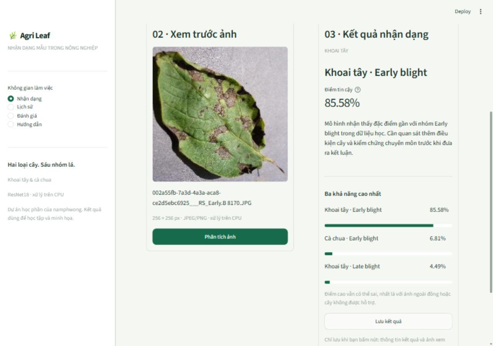

# Agri Leaf Disease Recognition

[](https://github.com/namphwong/agri-leaf-disease-recognition/actions/workflows/ci.yml)

Đồ án học phần **Nhận dạng mẫu** của **namphwong**: xây dựng ứng dụng nhận dạng bệnh trên lá khoai tây và cà chua sử dụng ResNet18.

Fork từ [Smart Leaf AI của spneoarm](https://github.com/spneoarm/smart-leaf-ai), giữ nguyên lịch sử và [MIT License](LICENSE). Chi tiết kế thừa tại [ACKNOWLEDGEMENTS.md](ACKNOWLEDGEMENTS.md); [README gốc](docs/upstream-README.md) được lưu để đối chiếu.

## Trạng thái

Phase 0–5 đã hoàn thành. **Phase 6 đã kiểm chứng checkpoint trên 776 ảnh, công bố metrics/confusion matrix/ví dụ lỗi và CI**; xem [thực nghiệm](docs/evaluation.md). Agri Leaf có UI tiếng Việt, SQLite/CSV và dữ liệu sáu lớp. Checkpoint/notebook giữ nguyên, chưa huấn luyện lại. Các chỉ số là kiểm chứng có nguy cơ trùng huấn luyện, không phải test độc lập; yêu cầu riêng giảng viên vẫn chờ xác nhận.



Ảnh lá minh họa: PlantVillage, ứng viên train của dự án, CC BY-SA 3.0 theo dataset card; xem [ghi nguồn](ACKNOWLEDGEMENTS.md).

## Phạm vi

Ảnh một lá JPG/JPEG/PNG → một trong sáu lớp: Potato/Tomato × Early blight/Late blight/healthy. Bản gốc dùng PyTorch, ResNet18, Streamlit và có sẵn checkpoint trong `models/leaf_model_final.pth`.

Đã có: UI tiếng Việt, chọn ảnh mẫu hoặc upload, xem trước, phân tích, top 3/điểm tin cậy, lịch sử SQLite với thumbnail, lọc/xóa và CSV. Trang Đánh giá có accuracy, precision/recall/F1 từng lớp, confusion matrix, ví dụ lỗi và thời gian từ thực nghiệm thực tế, kèm phạm vi và giới hạn.

## Lấy mã nguồn

```powershell
git clone https://github.com/namphwong/agri-leaf-disease-recognition.git
cd agri-leaf-disease-recognition
git remote add upstream https://github.com/spneoarm/smart-leaf-ai.git
```

`origin` trỏ đến repo namphwong; `upstream` trỏ đến tác giả gốc.

## Chạy bản kế thừa đã kiểm chứng trên Windows

Cần Git và Python 3.11.9 x64. Môi trường đã kiểm chứng: PyTorch 2.8.0 CPU, torchvision 0.23.0, Streamlit 1.67.0. Dùng lockfile để cài đúng toàn bộ phiên bản runtime.

```powershell
python -m venv .venv
.\.venv\Scripts\python.exe -m pip install -r requirements-lock.txt
.\.venv\Scripts\python.exe -m streamlit run app.py --server.address=127.0.0.1 --browser.gatherUsageStats=false
```

Mở http://localhost:8501. Không cần dataset để suy luận bằng checkpoint sẵn có. Windows trên máy kiểm chứng không tải được PyTorch 2.15.0/2.10.0, nên không tự nâng phiên bản đã ghim; xem [lịch sử tương thích](docs/baseline.md). Chưa chứng nhận lockfile trên OS/Python khác.

Upload nội dung JPEG/PNG, tối đa 20 MiB và 16 triệu pixel. Chọn ảnh → xem trước → bấm **Phân tích ảnh** → đọc kết quả → bấm **Lưu kết quả** nếu cần. Chỉ lưu thumbnail và metadata tại `storage/history.sqlite3`; lịch sử dùng chung trên máy chạy app, chưa có tài khoản riêng. [Cấu hình lịch sử và CSV](docs/history.md).

Không cần tải cả dataset để dùng ảnh mẫu: ứng dụng dùng ảnh cục bộ nếu có, nếu không chỉ tải ảnh được chọn từ snapshot GitHub public và kiểm tra checksum. Suy luận không gửi ảnh đến dịch vụ AI bên ngoài.

Chạy lại kiểm chứng bằng sáu ảnh đã ghim nguồn và checksum:

```powershell
.\.venv\Scripts\python.exe scripts/baseline_check.py --restore-samples --result-name local-results.json
```

## Dữ liệu và kết quả

- [PlantVillage GitHub](https://github.com/spMohanty/PlantVillage-Dataset), chọn sáu lớp trong `raw/color`.
- [Dataset card](https://huggingface.co/datasets/mohanty/PlantVillage), công bố CC BY-SA 3.0; dữ liệu có điều kiện riêng, không thuộc MIT của code.
- Tác giả gốc báo cáo test accuracy **93,69%**. Đây không phải kết quả namphwong tự đo.
- Baseline tự chạy: **6/6 ảnh mẫu khớp nhãn**, median CPU forward **27,06 ms/ảnh**; đây là smoke check, không phải accuracy test độc lập. [Kết quả thô](reports/baseline/results.json).
- Phase 6: **accuracy 92,27%, macro F1 91,85%**, 716/776 ảnh khớp nhãn, 194 nhóm lá; median decode + preprocessing + CPU prediction **33,59 ms/ảnh**. Đây là kiểm chứng checkpoint kế thừa có thể trùng train, không phải test độc lập. [Báo cáo và cách diễn giải](docs/evaluation.md).
- Không coi tập ảnh lấy từ PlantVillage là test độc lập của checkpoint kế thừa khi chưa xác định giao nhau với tập huấn luyện.

Phase 3 đã tải đủ 6.652 ảnh của sáu lớp vào `data/plantvillage-source/`, khoảng 110,31 MiB ảnh. Không có ảnh lỗi giải mã; có 14 cặp trùng chính xác. 1.582 ảnh thiếu mapping nhóm lá được giữ riêng; 5.070 ảnh đủ điều kiện được chia train/validation/test = **3.546/748/776**, seed 42, theo nhóm lá và các liên kết ảnh trùng. Đây là split dành cho huấn luyện lại, không tạo ra test độc lập cho checkpoint kế thừa.

Khôi phục dữ liệu và chạy audit (cần Git, internet và môi trường đã cài):

```powershell
.\.venv\Scripts\python.exe scripts/prepare_dataset.py --download
.\.venv\Scripts\python.exe -m unittest discover -s tests -v
```

Ảnh và Git cache nguồn được ignore; [manifest và thống kê](reports/dataset/summary.json) được commit để đối chiếu/tái lập. Không huấn luyện trực tiếp từ toàn thư mục ảnh mà bỏ qua cờ cách ly trong manifest. Xem [phạm vi dự án](docs/project-scope.md).

## Tài liệu và quản lý công việc

- [Phạm vi và tiêu chí nghiệm thu](docs/project-scope.md).
- [Roadmap Phase 0–8](docs/roadmap.md).
- [Baseline CPU và cách tái lập](docs/baseline.md).
- [Dữ liệu, thống kê và quy tắc đánh giá](docs/dataset.md).
- [Kiến trúc, API và kết quả hồi quy Phase 4](docs/architecture.md).
- [UI/UX, ảnh giao diện và nghiệm thu Phase 5](docs/ui-ux.md).
- [SQLite, quyền riêng tư cục bộ và xuất CSV](docs/history.md).
- [Kết quả thực nghiệm Phase 6, biểu đồ và CI](docs/evaluation.md).
- [Quy trình đóng góp](CONTRIBUTING.md).
- [Changelog](CHANGELOG.md).
- [GitHub Issues](https://github.com/namphwong/agri-leaf-disease-recognition/issues).
- [Milestones](https://github.com/namphwong/agri-leaf-disease-recognition/milestones).

## Cấu trúc hiện tại

```text
app.py                     # Điều hướng bốn trang
src/                       # Inference, preprocessing, labels, validation, SQLite
src/ui/                    # Nhận dạng, lịch sử, đánh giá, hướng dẫn
models/                    # Checkpoint gốc
notebooks/                 # Notebook huấn luyện gốc
docs/                      # Phạm vi, roadmap, tài liệu nguồn
scripts/baseline_check.py   # Kiểm chứng CPU và app kế thừa
scripts/prepare_dataset.py # Tải sáu lớp, audit và split theo nhóm
reports/baseline/          # Manifest và kết quả kiểm chứng
reports/dataset/           # Metadata ảnh, thống kê, split và nhãn
reports/evaluation/        # 776 dự đoán, metrics, confusion matrix và hình minh họa
tests/                     # 39 test dữ liệu, pipeline, UI, SQLite và đánh giá
.github/                   # Mẫu PR
requirements.txt           # Dependencies trực tiếp đã ghim
requirements-lock.txt      # Toàn bộ runtime Windows/Python 3.11
ACKNOWLEDGEMENTS.md        # Nguồn và phân biệt đóng góp
CONTRIBUTING.md            # Quy trình GitHub
.streamlit/config.toml     # Theme và giới hạn upload
.github/workflows/ci.yml   # Kiểm thử offline, không train mỗi commit
```

Xuất lại thực nghiệm (cần dữ liệu Phase 3 và dependencies vẽ hình bổ sung):

```powershell
.\.venv\Scripts\python.exe -m pip install -r requirements-dev.txt
.\.venv\Scripts\python.exe scripts/evaluate.py
.\.venv\Scripts\python.exe scripts/check_evaluation.py
```

Chạy test/đọc báo cáo không cần matplotlib hoặc tải toàn dataset. CI dùng runtime lock, không chạy huấn luyện hoặc đánh giá lại 776 ảnh mỗi commit.

## Giới hạn

Mô hình luôn chọn một trong sáu lớp, chưa có cơ chế từ chối ảnh ngoài phạm vi được kiểm chứng. Điểm softmax không chứng minh ảnh hợp lệ hoặc kết luận đúng. Ảnh ngoài đồng có thể khác đáng kể với dữ liệu nền đơn giản. Ứng dụng phục vụ học tập; không đưa ra quyết định canh tác hoặc kê thuốc.
