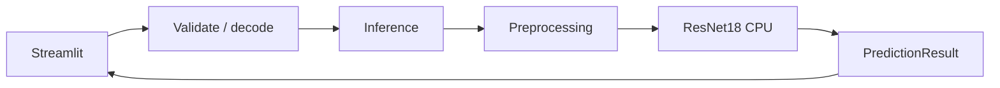

# Kiến trúc sau Phase 4

Ngày kiểm chứng: 12/11/2026. Mục tiêu: tách pipeline khỏi Streamlit, giữ kết quả trên ảnh hợp lệ. Không thay checkpoint hoặc dependencies, không huấn luyện lại.

## Phân chia trách nhiệm

| Thành phần | Trách nhiệm |
|---|---|
| `app.py` | Bố cục, cache tài nguyên, điều phối upload → predict → render và hiển thị lỗi |
| `src/config.py` | Đường dẫn tuyệt đối theo root dự án, không phụ thuộc thư mục làm việc |
| `src/labels.py` | Thứ tự sáu lớp, mô tả bệnh và cách định dạng nhãn; không import model/UI |
| `src/validation.py` | Xác minh bytes, định dạng thực, giới hạn và giải mã ảnh RGB |
| `src/preprocessing.py` | RGB → Resize 224×224 → ToTensor → batch dimension; không Normalize hoặc xoay EXIF |
| `src/inference.py` | Load state dict CPU, eval mode, softmax và kết quả có cấu trúc; không import Streamlit/storage |
| `src/storage.py` | Factory record lịch sử cho Phase 5; chưa ghi SQLite hoặc ảnh |



Import package `src` không tải mô hình hoặc tạo file. Tải mô hình chỉ xảy ra khi gọi `load_model`; database chưa được tạo.

## Hợp đồng suy luận

```python
from src.inference import load_model, predict
from src.validation import decode_image

loaded = load_model()
image = decode_image(image_bytes)
result = predict(loaded, image)
payload = result.to_dict()
```

`PredictionResult` chứa `class_index`, `label`, `confidence`; `top3` gồm index/label/score theo điểm giảm dần; `probabilities` gồm sáu điểm theo `CLASSES`; `device="cpu"`, `model_version` và `checkpoint_sha256`.

Điểm ở miền **0–1**; UI nhân 100 khi hiển thị. Khi bằng điểm, giữ thứ tự lớp gốc. `to_dict()` dùng được với `json.dumps`; tuple thành JSON array. Model version là `resnet18-` cộng 12 ký tự đầu checksum, không phải phiên bản huấn luyện hay bằng chứng độ chính xác.

Checkpoint đọc một lần thành bytes để tính SHA-256 và load với `weights_only=True`, `map_location=cpu`, `strict=True`, sau đó eval. Không tải ImageNet qua mạng khi suy luận.

## Cache và lỗi

Cache Streamlit theo đường dẫn, `mtime_ns` và dung lượng file. Khi metadata thay đổi, rerun tải model và tính version mới. Thiếu file được kiểm tra trước cache. Nếu thay file cùng dung lượng và cố ý giữ mtime, cần xóa cache hoặc khởi động lại app; đây không phải bộ theo dõi file nền.

Validation không tin phần mở rộng tên file: chỉ nhận nội dung JPEG/PNG, tối đa **20 MiB** và **16 triệu pixel**. Ảnh RGB, grayscale, RGBA chuyển về RGB, không thay kích thước ở bước decode. `verify()` và decode đầy đủ phát hiện file rỗng, hỏng hoặc cắt cụt. App bắt `ImageValidationError` và hiển thị lỗi; giới hạn có trong trợ giúp upload.

Đây là thay đổi kiểm tra đầu vào so với app gốc, không phải bộ phát hiện ảnh ngoài phạm vi. Ảnh hợp lệ của vật khác vẫn có thể bị gán một trong sáu lớp.

## Chuẩn bị lưu trữ

`make_history_record(result, image_name, image_bytes)` trả record schema 1 với thời gian Asia/Bangkok, tên file đã bỏ đường dẫn, SHA-256 ảnh và prediction. Hàm không giữ bytes ảnh và không thực hiện I/O.

`DEFAULT_HISTORY_PATH` dự kiến là `storage/history.sqlite3`; **chưa có database, lưu/đọc/xóa lịch sử hoặc CSV**, app chưa gọi factory này. Các chức năng đó vẫn thuộc Phase 5.

## Công cụ dữ liệu và regression

`prepare_dataset.py` lấy thứ tự lớp từ `src.labels`, không đọc AST giao diện; import công cụ dữ liệu không tải PyTorch/Streamlit. Manifest và split Phase 3 giữ nguyên.

`baseline_check.py` chạy pipeline hiện tại và trích tham chiếu load model/transform từ AST của `app.py` ở Git commit bất biến `7b021d59a970d6ae5da32cae81a0a4d025ad1748`. Đồng thời kiểm tra checksum và top 3/confidence với JSON Phase 2 đã lưu.

Script mặc định ghi `current-results.json`, giữ nguyên `results.json` và `repro-results.json`. Bản clone cần lịch sử chứa commit tham chiếu; shallow clone có thể cần fetch thêm commit.

## Bằng chứng kiểm chứng

- **15 unit test đạt**: 6 test dữ liệu, 9 test ảnh/giới hạn, thứ tự tie, schema, thiếu checkpoint, đường dẫn và record lịch sử.
- Sáu ảnh: nhãn, top 3 và điểm khớp Phase 2; chênh lệch lớn nhất giữa **toàn bộ sáu điểm đầu ra** của pipeline mới và tham chiếu bằng **0**, ngưỡng assertion 1e-7.
- Tensor preprocessing khớp notebook và mã trước refactor; checksum checkpoint không đổi.
- AppTest startup, sáu luồng ảnh, file lỗi và HTTP server đều đạt.
- Chạy script bằng đường dẫn tuyệt đối từ `D:\TLU` vẫn đạt, gồm các lượt AppTest.
- [Kết quả thô](../reports/baseline/phase4-results.json): median forward khoảng **24,76 ms/ảnh**, không gồm decode/UI; chưa có cơ sở kết luận refactor tăng tốc mô hình.

```powershell
.\.venv\Scripts\python.exe -m unittest discover -s tests -v
.\.venv\Scripts\python.exe scripts/baseline_check.py --result-name phase4-local-results.json
```

Sáu ảnh chỉ là smoke/regression check, không phải test độc lập. Chưa kiểm tra thao tác upload bằng trình duyệt hoặc bố cục trực quan; UI/UX đầy đủ thuộc Phase 5–6.
