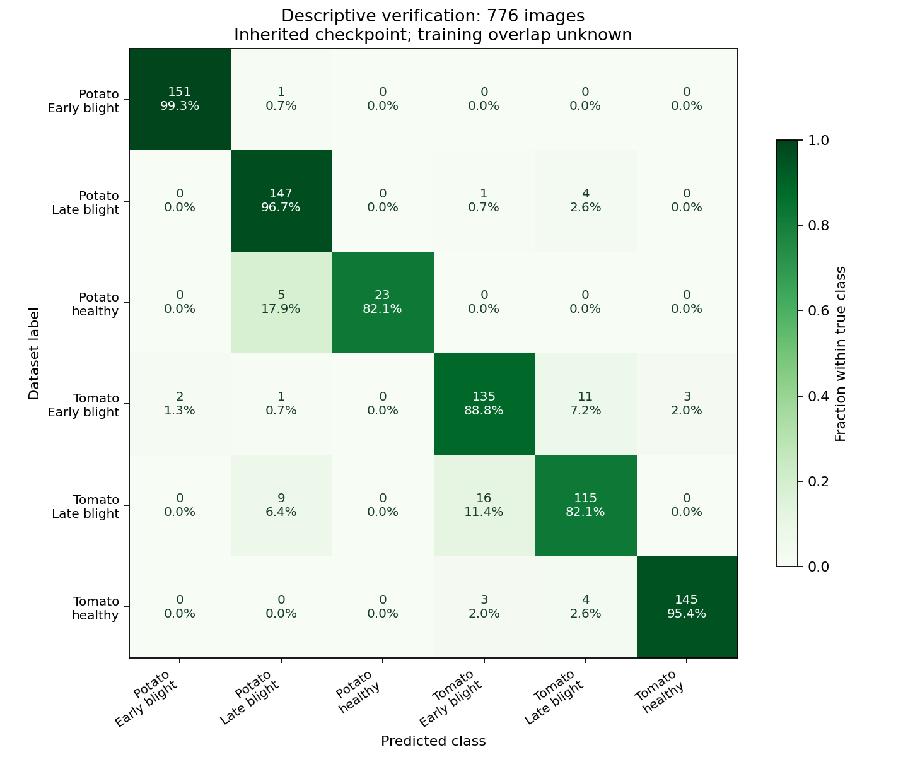
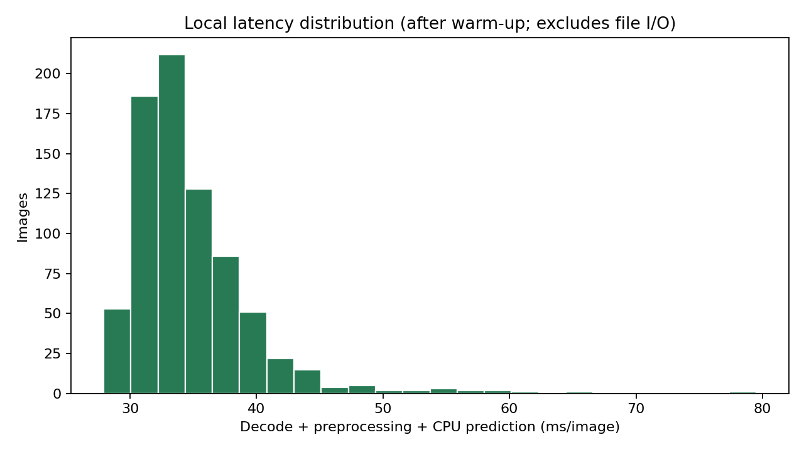

# Thực nghiệm và kiểm chứng — Phase 6

Ngày chạy: **13/11/2026**, Asia/Bangkok. Đánh giá mô tả checkpoint kế thừa trên 776 ảnh thuộc partition `test` của manifest Phase 3. **Không phải đánh giá test độc lập**: chưa biết các ảnh nào đã dùng huấn luyện checkpoint gốc. Không huấn luyện lại, chọn epoch, chỉnh threshold hoặc thay model từ kết quả này.

## 1. Cấu hình và tập ảnh

- Manifest: `reports/dataset/manifest.csv`, SHA-256 `43f4b83484c4977b0206a59635d89540070fa242b78bef6a32e79ee9d0052724`.
- Snapshot PlantVillage: `7f7ecc7e1eaca78107e3affe7cb5abd9427e139a`.
- Chỉ lấy hàng `split=test`, `use_for_training_evaluation=True`: **776 ảnh / 194 nhóm**, đủ sáu lớp.
- Không đưa 1.582 ảnh thiếu mapping hoặc các hàng đã bị loại ở Phase 3 vào đánh giá. Vì vậy kết quả không đại diện toàn bộ 6.652 ảnh gốc.
- Checkpoint: `resnet18-b20634ad7be7`, SHA-256 `b20634ad7be7da28e6a2345b7def1c217a877ce89e10d581d9b30ab5d152a963`.
- Python 3.11.9, torch 2.8.0+cpu, torchvision 0.23.0+cpu, NumPy 2.4.6, Pillow 13.0.0; Windows x64, CPU Ryzen 7 H 255, 8 PyTorch threads.
- Dùng đúng API production: decode/verify JPEG-PNG → RGB → Resize 224×224 → ToTensor → ResNet18 eval → softmax. Không augmentation, Normalize hoặc xoay EXIF thêm.
- Mọi ảnh được đối chiếu SHA-256 với manifest trước suy luận.

Report lưu commit nền trước khi triển khai runner cùng checksum của các file evaluator/pipeline thực tế. Checksum xác định nội dung code dùng khi đo, kể cả khi commit nền chưa chứa evaluator mới; sau đó evaluator và report đã được commit cùng nhánh Phase 6. Không dùng commit nền một mình để đại diện toàn bộ code thực nghiệm.

## 2. Chỉ số thực đo

| Chỉ số | Kết quả |
|---|---:|
| Khớp nhãn | 716 / 776 |
| Phân loại sai | 60 / 776 |
| Accuracy | **92,27%** |
| Precision macro | 93,29% |
| Recall macro | 90,76% |
| F1 macro | **91,85%** |
| F1 weighted | 92,24% |

| Lớp | Precision | Recall | F1 | Số ảnh |
|---|---:|---:|---:|---:|
| Potato — Early blight | 98,69% | 99,34% | 99,02% | 152 |
| Potato — Late blight | 90,18% | 96,71% | 93,33% | 152 |
| Potato — healthy | 100,00% | 82,14% | 90,20% | 28 |
| Tomato — Early blight | 87,10% | 88,82% | 87,95% | 152 |
| Tomato — Late blight | 85,82% | 82,14% | 83,94% | 140 |
| Tomato — healthy | 97,97% | 95,39% | 96,67% | 152 |

Precision = TP/(TP+FP), recall = TP/(TP+FN), F1 là trung bình điều hòa của precision/recall. Macro lấy trung bình đều trên sáu lớp cố định; weighted F1 theo support. Mẫu số bằng 0 trả 0, không âm thầm bỏ lớp khỏi macro. Hàm metrics có test trên ma trận biết trước, không hard-code kết quả dự án.

Bootstrap theo **group_id**, 1.000 lượt có hoàn lại, seed 42, percentile 2,5–97,5%:

- Accuracy: **89,82–94,46%**.
- F1 macro: **89,04–94,25%**.

Khoảng này chỉ mô tả biến thiên lấy mẫu theo nhóm của bộ dữ liệu hiện tại. Nó **không loại bỏ rò rỉ huấn luyện**, sai metadata hoặc domain shift. Potato healthy test chỉ có 7 nhóm lá, nên không đọc precision 100% của lớp này thành bằng chứng nhận dạng hoàn hảo.

## 3. Confusion matrix và phân tích lỗi



Hàng là nhãn nguồn, cột là dự đoán; ô thể hiện số ảnh và tỷ lệ trong hàng. Các nhầm lẫn nổi bật:

- 16/140 Tomato Late blight được dự đoán Tomato Early blight.
- 11/152 Tomato Early blight được dự đoán Tomato Late blight.
- 5/28 Potato healthy được dự đoán Potato Late blight.
- Có lỗi lẫn loại cây: 9 Tomato Late blight sang Potato Late blight, cùng một số lỗi khác.

Đây là mô tả nhầm nhãn, không khẳng định nguyên nhân bệnh học từ ảnh. Muốn giải thích vì sao model chú ý sai cần thực nghiệm riêng; chưa có Grad-CAM hoặc đánh giá của chuyên gia.

[examples.png](../reports/evaluation/examples.png) gồm một ảnh đúng có điểm thấp nhất mỗi lớp và tối đa sáu ảnh sai có điểm cao nhất, chọn sau đánh giá để minh họa. Đường dẫn, checksum và điểm trong [examples.json](../reports/evaluation/examples.json). Có lỗi với điểm khoảng **97,1%**, cho thấy điểm softmax cao không bảo đảm đúng. Không dùng các ví dụ để điều chỉnh model/threshold trong phase này.

## 4. Thời gian xử lý

- Warm-up 3 lượt, sau đó tuần tự 776 ảnh, mỗi ảnh batch 1 trên CPU.
- Median decode + validation + preprocessing + predict: **33,59 ms/ảnh**.
- p95 cùng phạm vi: **42,70 ms/ảnh**.
- Median riêng `predict()` (gồm preprocessing/forward/softmax): **32,70 ms/ảnh**.
- Vòng đo tổng gồm đọc file và checksum: khoảng **28,81 giây**.

Không gồm toàn bộ tương tác trình duyệt, khởi động server hoặc load model. Không so tốc độ trực tiếp với forward-only của baseline vì phạm vi đo khác nhau. Kết quả phụ thuộc CPU, số threads và tải máy.



## 5. Artifacts và tính toàn vẹn

| File | Nội dung |
|---|---|
| [latest.json](../reports/evaluation/latest.json) | Metrics, per-class, ma trận, interval, cấu hình, nguồn/checksum, giới hạn |
| [predictions.csv](../reports/evaluation/predictions.csv) | Đủ 776 ảnh, group/nhãn/index/dự đoán/sáu điểm/thời gian/hash |
| [confusion_matrix.png](../reports/evaluation/confusion_matrix.png) | Ma trận số lượng và tỷ lệ theo hàng |
| [latency.png](../reports/evaluation/latency.png) | Histogram thời gian |
| [examples.png](../reports/evaluation/examples.png) | Contact sheet đúng/sai, nguồn PlantVillage ghi trên hình |
| [examples.json](../reports/evaluation/examples.json) | Quy tắc chọn và metadata từng ví dụ |

`src/evaluation.py` xác minh scope `independent_test=False`, thứ tự lớp, checkpoint/manifest, tập ảnh đúng 776 hàng không trùng, group/hash, argmax/confidence từ sáu điểm; dựng lại confusion matrix và metrics từ CSV; kiểm tra hash hình. UI chỉ hiển thị chỉ số sau khi kiểm tra này đạt. Test cố ý sửa accuracy, cờ độc lập hoặc CSV đều phải bị từ chối.

Các hình đã được mở kiểm tra độ đọc, tiêu đề và chú thích. Trang Đánh giá đã được kiểm tra browser ở laptop 1280×900; các chỉ số/cảnh báo khớp JSON, tab ma trận hiển thị hình. [Screenshot](screenshots/phase6-evaluation.jpg). Kiểm tra DOM tại viewport 390 px không có tràn ngang toàn trang; chưa chứng nhận trên điện thoại thật.

Ảnh ví dụ là PlantVillage, Mohanty et al. (2016), dataset card công bố CC BY-SA 3.0; xem [ACKNOWLEDGEMENTS](../ACKNOWLEDGEMENTS.md). Không commit toàn bộ ảnh test/raw dataset. Hình ma trận và histogram do script dự án tạo.

## 6. Tái lập

Từ root dự án, sau khi cài runtime lock và tải dữ liệu Phase 3:

```powershell
.\.venv\Scripts\python.exe -m pip install -r requirements-dev.txt
.\.venv\Scripts\python.exe scripts/prepare_dataset.py --download
.\.venv\Scripts\python.exe scripts/evaluate.py
.\.venv\Scripts\python.exe scripts/check_evaluation.py
```

Runner không train hoặc tối ưu; chỉ nhận cohort test hiện tại, kiểm tra hash và dùng checkpoint cố định. Chạy lại sẽ ghi đè artifacts cùng tên; timing/timestamp thay đổi, không coi file hash của một lần chạy là bất biến cho mọi lần đo.

Nếu chỉ đọc báo cáo hoặc chạy test/CI, không cần matplotlib hoặc tải ảnh dataset. Matplotlib 3.10.8 và các dependency bổ sung đã ghim trong `requirements-dev.txt` chỉ dùng xuất hình.

## 7. Kiểm thử và CI

**39 test cục bộ đạt**, gồm 32 test pipeline/UI/dữ liệu/SQLite và 7 test metrics/artifact mới. Vẫn bao phủ ảnh lỗi/xám/alpha, model thiếu, đổi ảnh, lỗi DB, lưu/xuất/xóa và concurrency.

Workflow [CI](../.github/workflows/ci.yml) chạy Windows latest, Python 3.11.9, cài runtime lock, pip check, compileall, unit/AppTest và xác minh artifacts offline. Không tải dataset, không huấn luyện, không chạy lại 776 ảnh trên mỗi commit. Actions checkout/setup-python dùng commit SHA của bản phát hành chính thức; quyền token chỉ `contents: read`.

CI thực tế: xem [GitHub Actions](https://github.com/namphwong/agri-leaf-disease-recognition/actions). Trạng thái của commit hiện tại là nguồn xác nhận; không coi “đã có file YAML” là CI đã chạy thành công.

## 8. Cách dùng trong báo cáo học phần

Nên viết: “Checkpoint kế thừa đạt accuracy 92,27% và macro F1 91,85% khi kiểm chứng trên 776 ảnh của partition dự án; không loại trừ giao nhau với dữ liệu huấn luyện gốc.”

Không viết “đạt 92,27% trên tập test độc lập” hoặc “tốt hơn/kém hơn 93,69% của tác giả” vì tập đánh giá và provenance khác nhau. Muốn báo cáo độc lập phải huấn luyện lại từ khởi tạo phù hợp theo train/validation/test đã nhóm lá; ngoài phạm vi phase này và vẫn phụ thuộc yêu cầu giảng viên chưa xác nhận.
